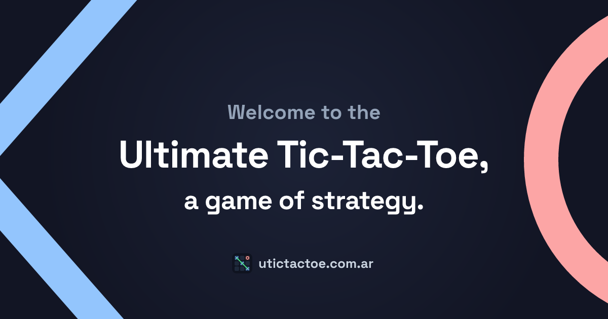

# Ultimate Tic-Tac-Toe



A playable Ultimate Tic-Tac-Toe, with live games against people and against bots, including a port of the strongest published network for the game.

**[Play at utictactoe.com.ar](https://utictactoe.com.ar)**

## The game

Ultimate Tic-Tac-Toe is nine tic-tac-toe boards arranged as one. Winning a small board claims that cell of the big board, and the game is won by taking three big-board cells in a line.

The rule that makes it a strategy game rather than nine separate ones: the cell you play in sends your opponent to the matching small board. Play in the top-right cell of a small board and they must answer in the top-right board. A board that is already won or full is a free choice, and they may play anywhere still open.

X moves first, on any cell of any board.

## Opponents

The site seats four bots. Their strength is not assigned by hand. `python -m arena rate` plays a round robin from shared openings, with colors swapped, and fits a Bradley–Terry model on the Elo scale. Random play is pinned at 500, so the numbers stay comparable when the roster changes. A level is one 400-point step, about a 91% expected score for the stronger side.

| | Bot | Rating | Level | How it plays |
|---|---|---:|---|---|
| 🎲 | Randy | 500 | Beginner | Uniform random legal moves. |
| 🤑 | Greedy | 840 | Easy | Takes a small board when it can, otherwise the move that looks best immediately. |
| 🍀 | Jardinero | 1229 | Intermediate | Alpha-beta search with a positional evaluation of small boards. |
| 🦊 | Arky | 1676 | Hard | [NMCTS2](https://github.com/arnowaczynski/utttai) by Arkadiusz Nowaczyński, the network behind [uttt.ai](https://uttt.ai), searched with 1,000 simulations. |

Ratings are from 24 games per pair (12 openings, both colors), generated 2026-10-24. Regenerate them with:

```bash
cd backend
uv run python -m arena rate
```

That writes `backend/data/bot_ratings.json`, which the site reads. Jardinerito, a shallower search of the same kind as Jardinero, is in the tree and can be seated in the arena, but it is not offered on the site.

## Credit

Arky is not our model. The policy-value network is NMCTS2, trained and published by Arkadiusz Nowaczyński as part of [uttt.ai](https://uttt.ai) ([arnowaczynski/utttai](https://github.com/arnowaczynski/utttai)), under the Apache License 2.0. The weights file is the one served to the browser at [uttt.ai/policy_value_net_stage2.onnx](https://uttt.ai/policy_value_net_stage2.onnx). A copy of the license is in `backend/licenses/utttai-Apache-2.0.txt`, and `backend/NOTICE` records the attribution.

His engine is also the rules oracle for this project. `scripts/fetch_utttai.sh` clones it, and `python -m arena verify` checks our rules and feature encoding against his.

## Layout

```
frontend/     Next.js app: the board, lobby, and learn pages
backend/
  core/       Rules, the position, the live game engine, and the game store
  api/        HTTP routes and the Socket.IO game namespace
  bots/       Randy, Greedy, Jardinerito, Jardinero, and Arky
  arena/      Matches, the uttt.ai adapters, and the rating fit
  data/       The evaluation table and bot_ratings.json
ops/deploy/   The script the production runner executes
```

One set of rules serves the engine, the bots, and the client. A position is immutable: nine small-board indexes, who moves, and which board is forced. Bots take a position and return a move. They keep no per-game state, so one loaded instance plays every game.

## Run it locally

Node.js 22, Python 3.11, and [uv](https://docs.astral.sh/uv/).

```bash
npm run install:frontend
npm run install:backend
bash scripts/fetch_utttai.sh
curl -fL -o backend/weights/policy_value_net_stage2.onnx \
  https://uttt.ai/policy_value_net_stage2.onnx
npm run dev
```

The site is at [localhost:3000](http://localhost:3000) and the API at [localhost:5000](http://localhost:5000). Without the weights file the other bots still play; Arky refuses to move and says where to put the file.

`npm run dev:frontend` and `npm run dev:backend` start either half on its own.

## Arena

From `backend/`:

```bash
uv run python -m arena verify          # rules and features against uttt.ai
uv run python -m arena play --x arky --o jardinero --games 4
uv run python -m arena rate            # rewrite data/bot_ratings.json
```

`play` accepts `randy`, `greedy`, `jardinerito`, `jardinero`, `arky`, and `nmcts2`. The last of those seats his own search rather than our port of it.

## Production

Two containers, defined in `compose.production.yml`: Next.js, and Flask with Socket.IO under Gunicorn and gevent. A reverse proxy on one origin sends `/socket.io`, `/get-bot-list`, `/queue-counts`, and `/health` to the API and everything else to the frontend.

A push to `main` runs `.github/workflows/deploy.yml` on a self-hosted runner, which republishes the tree and rebuilds the containers. The NMCTS2 weights are not in git. They are mounted into the API container from `backend/weights` on the host, so a deploy does not have to refetch them and does not bake them into the image.

## License

Copyright 2026 Manuel Delpino. This project is licensed under the Apache License 2.0. See [LICENSE](LICENSE).

That grant covers the game, the bots, and any model published from this repository. It includes a patent license from each contributor, which is the term that matters once a trained network is part of what we ship.

The NMCTS2 weights are not covered by that copyright. They remain Arkadiusz Nowaczyński's work under the Apache License 2.0, as recorded in `backend/NOTICE`.
